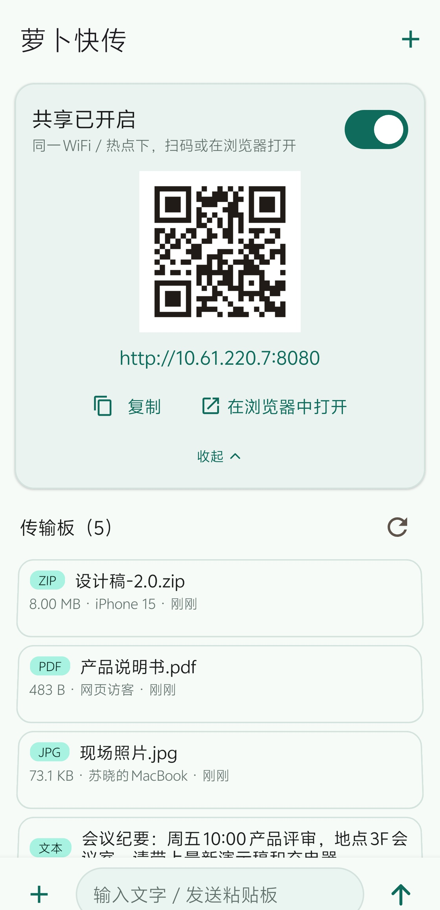
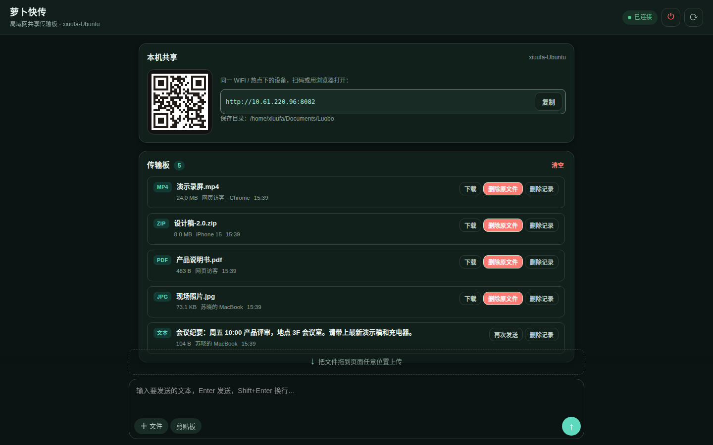

# 萝卜快传（Luobo Kuaichuan）

> 局域网 / 热点内的**任意格式极速互传**工具：手机、电脑、浏览器通过同一块「共享传输板」收发文本与文件。
> 不登录、不过云、不限速，打开网页就能用。

## 下载

| 平台 | 文件 | 安装方式 |
| --- | --- | --- |
| Android 8.0+ | [萝卜快传-1.0.0.apk](release/萝卜快传-1.0.0.apk) | 下载后安装，需允许「安装未知来源应用」 |
| Windows 10/11 x64 | [萝卜快传-1.0.0-windows-x64.zip](release/萝卜快传-1.0.0-windows-x64.zip) | 解压后双击 `LuoboKuaichuan.exe`，便携单文件 |
| Linux x86_64 | [萝卜快传-1.0.0-linux-x86_64.AppImage](release/萝卜快传-1.0.0-linux-x86_64.AppImage) | `chmod +x` 后双击运行 |

```bash
# Linux：赋予执行权限并运行
chmod +x 萝卜快传-1.0.0-linux-x86_64.AppImage
./萝卜快传-1.0.0-linux-x86_64.AppImage

# 校验下载文件（可选）
sha256sum -c SHA256SUMS.txt
```

所有预编译包都在 [`release/`](release/) 目录，校验值见 [`release/SHA256SUMS.txt`](release/SHA256SUMS.txt)。

> 仓库不包含任何签名密钥、Token 或本地配置。Android 正式包使用发布者自己的 keystore 签名。

「萝卜快传」沿用 `com.lobo.app` 包名与品牌，但 HTTP 服务、传输板、网页端与桌面端均为重写实现：
纯 HTTP + 原生网页，不依赖任何私有协议或外部服务。

- **Android**：Kotlin，minSdk 26（Android 8.0+），前台服务常驻共享
- **Windows / Linux**：C++17 单文件便携程序，内嵌网页与二维码
- **网页端**：原生 HTML / CSS / JS，无外网依赖，深色 / 浅色自适应
- **协议**：HTTP/1.1 + JSON，1 MB 分片上传，Range 断点下载

## 界面预览

<table>
  <tr>
    <td align="center"><br><sub>Android 主机 · 二维码与传输板</sub></td>
    <td align="center"><br><sub>网页端 · 桌面浏览器</sub></td>
  </tr>
</table>

## 30 秒上手

1. **手机开启共享**：打开 App，点「共享」开关；首次按提示授予通知与「所有文件访问」权限。
2. **另一台设备加入**：同一 WiFi / 热点下，扫描手机上的二维码，或在浏览器输入页面显示的地址（如 `http://192.168.1.23:8080`）。
3. **开始互传**：在网页或 App 中拖拽文件、粘贴文字；所有设备实时看到同一块传输板。

没有接收方时也可以先分享进来：从微信、相册、文件管理选择「分享」→「萝卜快传」，App 会自动开启共享并把内容放进传输板，对方扫码即可下载。

## 核心功能

- **共享传输板**：所有端看到同一份列表，文本 / 任意格式文件实时同步，接收进度可见。
- **任意格式**：不限制扩展名，单文件上限 16 GB；图片、视频、压缩包、APK、ISO、文档均可。
- **分片与续传**：1 MB 分片上传，断网后从服务端 offset 继续；下载支持 HTTP Range，可暂停 / 继续。
- **系统分享入口**：其它 App 分享文件或文字给萝卜快传即可发送；未连接电脑时自动开启本机共享。
- **扫码连接**：App 内置扫一扫，可加入另一台主机的传输板；主机模式下会先确认关闭本机共享。
- **文件落盘**：Android 保存到 `内部存储/Luobo`；桌面端保存到数据目录，重名自动加序号。
- **左滑操作**：打开文件所在位置 / 删除原文件 / 删除记录；半滑展开、继续滑到底删除，带速度投影与弹簧回弹。
- **后台常驻**：Android 前台服务 + CPU/WiFi 锁，锁屏后仍保持共享（通知栏可停止）。
- **网页端零安装**：桌面 / 手机浏览器直接打开；支持拖拽、粘贴、深浅色主题与断点下载。
- **优雅退出**：桌面端收到关闭信号、网页端退出服务、Android 停止共享时都会释放端口与资源。

## 三端形态

| 端 | 角色 | 说明 |
| --- | --- | --- |
| Android App | 主机 / 客户端 | 开共享时是主机；扫码后是另一台主机的客户端 |
| Windows / Linux | 主机 | 双击启动 HTTP 服务并打开浏览器；也可只作为网页端被访问 |
| 浏览器 | 客户端 | 桌面或手机浏览器，无需安装 |

## 架构

```
Android App（主机 / 客户端） ─┐
Windows / Linux（主机）      ─┼── HTTP API ── 共享传输板（board.json）
浏览器（客户端）             ─┘                 └─ 文件存储（Luobo/）
```

- **单一数据源**：传输板是唯一状态，网页、App、外部 API 读写同一份数据。
- **App 自身也是 HTTP 客户端**：主机模式连 `127.0.0.1`，扫码模式连远端主机，原生 UI 与网页行为一致。
- **无数据库、无云端**：一个进程、一个端口、一块板；文件直接落到本机目录。

协议与字段详见 [docs/API.md](docs/API.md)；桌面端细节见 [docs/DESKTOP.md](docs/DESKTOP.md)。

## 构建

### Android

```bash
# 需要 JDK 17+、Android SDK（compileSdk 37）
./gradlew :app:assembleRelease
# 产物：app/build/outputs/apk/release/app-release-unsigned.apk
# 使用你自己的 keystore 签名后再分发，仓库不包含签名密钥
```

调试安装：

```bash
./gradlew :app:assembleDebug
adb install -r app/build/outputs/apk/debug/app-debug.apk
```

单元测试：

```bash
./gradlew :app:testDebugUnitTest
```

### Windows（交叉编译）

需要 [zig](https://ziglang.org/) 0.13+、Python 3 + Pillow：

```bash
cd desktop
ZIG=/path/to/zig bash tools/build_windows.sh
# 产物：desktop/dist/LuoboKuaichuan.exe（无控制台窗口，单文件便携）
```

首次运行如出现 Windows 防火墙提示，请选择「允许访问」，否则局域网设备无法连接。

### Linux

```bash
cd desktop
bash tools/build_linux.sh       # 单文件二进制
bash tools/build_appimage.sh    # AppImage 安装包
```

`build_appimage.sh` 会优先使用 `appimagetool`；没有时可用 `runtime + squashfs` 手动组装。详见 [docs/DESKTOP.md](docs/DESKTOP.md)。

### 图标

三端图标保持同一份源图：

```bash
python3 desktop/tools/make_icon.py   # 从 Android xxxhdpi 图标生成 PNG / ICO（含 256px）
```

桌面端构建脚本会自动把 `generated/luobo.ico` 编进 Windows exe，并把 `generated/luobo.png` 打进 AppImage。

## 目录结构

```
app/                         Android 工程
  src/main/assets/web/       网页端（HTML/CSS/JS）
  src/main/java/com/lobo/app/
    MainActivity.kt          共享 / 二维码 / 传输板 / 分享入口 / 上传队列
    data/                    传输板、HTTP 客户端、上传器、设置
    http/                    NanoHTTPD 服务、Range、二维码、静态资源
    service/HttpServerService.kt
    ui/                      BoardAdapter / SwipeActionLayout
desktop/                     C++17 桌面端
  src/                       main.cpp / board.cpp / qr.cpp
  third_party/               cpp-httplib / nlohmann json / qrcodegen
  tools/                     gen_assets.py / make_icon.py / build_*.sh
  generated/                 luobo.png / luobo.ico（构建产物）
docs/                        API.md / DESKTOP.md / screenshots/
release/                     预编译 APK / Windows zip / Linux AppImage / SHA256SUMS.txt
tools/luobo_api.py           Python 客户端与 CLI
```

## HTTP API（节选）

| 方法 | 路径 | 说明 |
| --- | --- | --- |
| GET | `/api/info` | 主机信息、设备名、地址、上限 |
| GET | `/api/list?since=N` | 传输板列表（含进度） |
| POST | `/api/text` | 发送文本 |
| POST | `/api/upload/init` | 初始化文件上传 |
| PUT | `/api/upload/{id}?offset=N` | 上传分片（可续传） |
| POST | `/api/upload/{id}/complete` | 完成上传 |
| GET | `/api/file/{id}` | 下载文件（支持 Range） |
| DELETE | `/api/item/{id}` | 删除条目 |
| POST | `/api/clear` | 清空传输板 |
| POST | `/api/shutdown` | 退出桌面端服务（仅本机） |

完整字段与示例见 [docs/API.md](docs/API.md)。Python 示例：

```python
from tools.luobo_api import LuoboClient

client = LuoboClient("http://127.0.0.1:8080")
client.send_text("来自 Python 的文本", sender="python")
client.upload_file("./report.pdf", sender="python")
```

## 安全与隐私

- **只在局域网内通信**：不经过云端，不需要账号，不收集手机号 / 邮箱。
- **文件留在本机**：Android 写入 `内部存储/Luobo`；桌面端写入指定数据目录。
- **随时停止**：关闭共享或退出服务即释放端口；桌面端支持优雅关闭。
- **仓库不含密钥**：`keystore/`、`*.jks`、`local.properties`、Token 均已加入 `.gitignore`。
- **签名说明**：`release/` 中的 APK 由发布者签名；从源码构建的 APK 默认未签名。

## 兼容性

- Android 8.0 及以上（minSdk 26）。
- Windows 10 / 11 x64；Linux x86_64（AppImage）。
- 现代浏览器（Chrome / Edge / Firefox / Safari）。
- 手机热点、家庭路由器、公司局域网均可；跨网段或开启 AP 隔离时可能无法互访。

## 致谢

- 网页端与 HTTP 服务骨架受 **Gazee** 项目启发，在其基础上重写为任意格式传输服务。
- 依赖：[NanoHTTPD](https://github.com/NanoHttpd/nanohttpd)、[cpp-httplib](https://github.com/yhirose/cpp-httplib)、[nlohmann/json](https://github.com/nlohmann/json)、[qrcodegen](https://github.com/nayuki/QR-Code-generator)、ZXing。

## 许可证

MIT License，详见 [LICENSE](LICENSE)。
